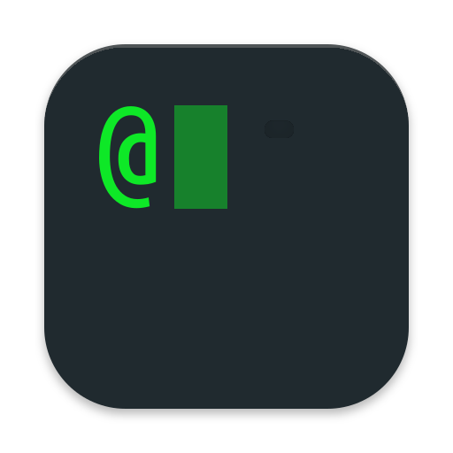

<p align="center">
 <picture>
  <source media="(prefers-color-scheme: dark)" srcset="https://github.com/atuinsh/atuin/assets/53315310/13216a1d-1ac0-4c99-b0eb-d88290fe0efd">
  
</picture>
</p>

<p align="center">
<em>making your terminal magical</em>
</p>

<hr/>

<p align="center">
  <a href="https://buildkite.com/atuin/atuin"></a>
  <a href="https://crates.io/crates/atuin"></a>
  <a href="https://crates.io/crates/atuin"></a>
  <a href="https://github.com/atuinsh/atuin/blob/main/LICENSE"></a>
  <a href="https://docs.atuin.sh"></a>
  <a href="https://forum.atuin.sh"></a>
  <a href="https://discord.gg/Fq8bJSKPHh"></a>
  <a href="https://web.libera.chat/#atuin"></a>
  <a rel="me" href="https://hachyderm.io/@atuin"></a>
  <a href="https://bsky.app/profile/atuin.sh"></a>
  <a href="https://twitter.com/atuinsh"></a>
</p>

Atuin captures everything you do in your terminal, from **all your agentic AI
work**, to all your **terminal history**, enabling you to:

* Let your agents see things you've worked on today, yesterday, a month or a
  year ago.
* Gain context on any work you've ever done in the terminal. If it happened in
  a terminal, Atuin lets you see it!
* Optionally, securely, sync your shell history and AI sessions across all your
  machines.

Atuin is secure by design, even when syncing: everything it syncs is
end-to-end encrypted, and nobody (including you, if you forget the key) can
decrypt it. We're very careful around secrets and avoid storing data with secrets.

# Quick Start

```bash
curl --proto '=https' --tlsv1.2 -LsSf https://setup.atuin.sh | sh
```

Then, **restart your shell**.

## History

Atuin captures everything you do in the terminal, storing it into a SQLite
database. Hitting <kbd>CTRL</kbd><kbd>r</kbd> opens a pretty pane with all
your bash history. Atuin logs your _exit codes_, _working directories_,
_hostnames_, _command duration_ and much much more. You can
hit <kbd>Return</kbd> to execute a command, <kbd>Tab</kbd> to edit any
highlighted command.

<p align="center">
  <picture>
    <source media="(prefers-color-scheme: dark)" srcset="https://atuin-demos.pages.dev/search-dark.webp">
    
  </picture>
</p>


Agents can search your history too:

<p align="center">
  <picture>
    <source media="(prefers-color-scheme: dark)" srcset="https://atuin-demos.pages.dev/history-dark.webp">
    
  </picture>
</p>

As well as the search UI, `atuin` has a CLI interface for searching commands:

```bash
# search for all successful `make` commands, recorded after 3pm yesterday
atuin search --exit 0 --after "yesterday 3pm" make
```

## Threads

Atuin captures what your agents do. Automatically move your
context and thread history from one machine to another, or from one harness to
another.

With _Atuin Threads_, your agent has access to your full history, and the
built-in Atuin MCP gives your agent context on everything you've ever done.

<p align="center">
  <picture>
    <source media="(prefers-color-scheme: dark)" srcset="https://atuin-demos.pages.dev/mcp-dark.webp">
    
  </picture>
</p>

You can take a session you started on your personal computer in Claude Code,
and `$ atuin resume` it in a remote machine inside Codex.

<p align="center">
  <picture>
    <source media="(prefers-color-scheme: dark)" srcset="https://atuin-demos.pages.dev/threads-dark.webp">
    
  </picture>
</p>

Similarly to the _history_ index, you can search through your _threads_:

```bash
atuin threads search 'c++'
```

## Sync

Atuin syncs all your AI threads, your shell sessions across all your computers
(even ephemeral VMs!). You can either use the official [Atuin
Service](https://atuin.sh) or you can self-host the sync server. **Everything it
syncs is end-to-end encrypted.**

##

Atuin supports
[ `zsh`](https://www.zsh.org/),
[ `bash`](https://www.gnu.org/software/bash/),
[ `fish`](https://fishshell.com/),
[ `nushell`](https://www.nushell.sh/),
[ `xonsh`](https://xon.sh/) and
[ `PowerShell`](https://learn.microsoft.com/en-us/powershell/)
as well as
[ `Claude Code`](https://claude.com/product/claude-code),
[ `Codex`](https://openai.com/codex/),
[<picture><source media="(prefers-color-scheme: dark)" srcset="assets/icons/opencode-dark.svg"></picture> Opencode](https://opencode.ai/),
[<picture><source media="(prefers-color-scheme: dark)" srcset="assets/icons/copilot-dark.svg"></picture> Copilot](https://github.com/features/copilot),
[<picture><source media="(prefers-color-scheme: dark)" srcset="assets/icons/grok-dark.svg"></picture> Grok](https://x.ai/build),
[<picture><source media="(prefers-color-scheme: dark)" srcset="assets/icons/hermes-dark.svg"></picture> Hermes](https://hermes-agent.nousresearch.com/),
and many more.

Atuin does so much more and we have [extensive
documentation](https://docs.atuin.sh/)! If you ever need help, reach out to us
through our [communities](#community).

## Related projects

* [Catpuccin for Atuin](https://github.com/catppuccin/atuin)
* [eshell-atuin](https://github.com/SqrtMinusOne/eshell-atuin)
* [mob (tiny creatures in your terminal)](https://github.com/bboynton97/mob)

Please open a PR for any others!

# Community

<p align="center">
  <a href="https://forum.atuin.sh"></a>
  <a href="https://discord.gg/Fq8bJSKPHh"></a>
  <a href="https://web.libera.chat/#atuin"></a>
  <a rel="me" href="https://hachyderm.io/@atuin"></a>
  <a href="https://bsky.app/profile/atuin.sh"></a>
  <a href="https://twitter.com/atuinsh"></a>
</p>

## Contributors

We are very grateful to all our contributors!

<a href="https://github.com/atuinsh/atuin/graphs/contributors">
  
</a>

_Made with [contrib.rocks](https://contrib.rocks)._
