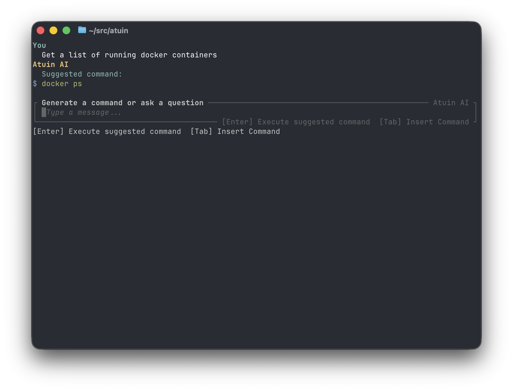
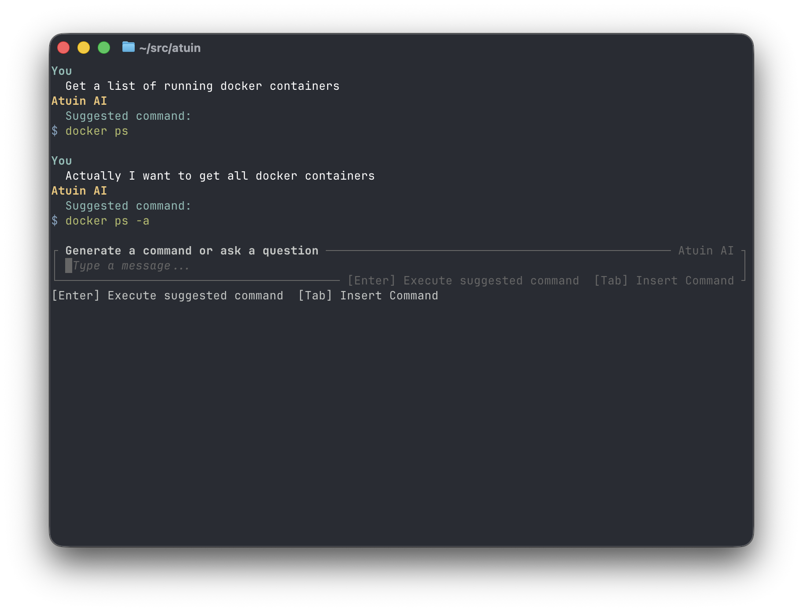
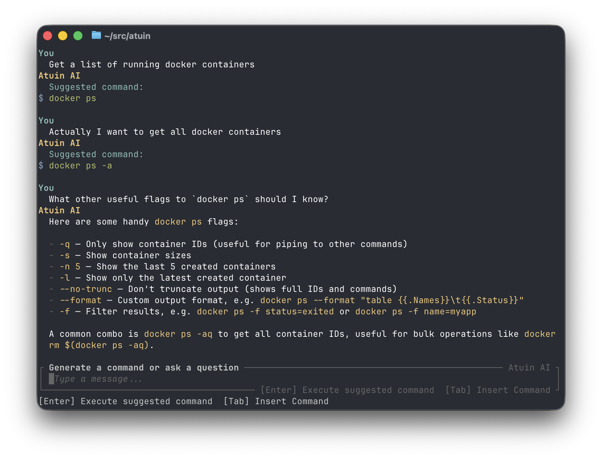
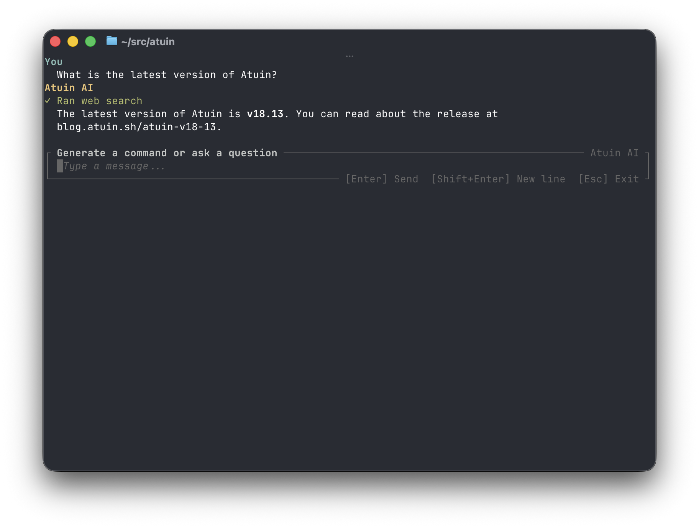
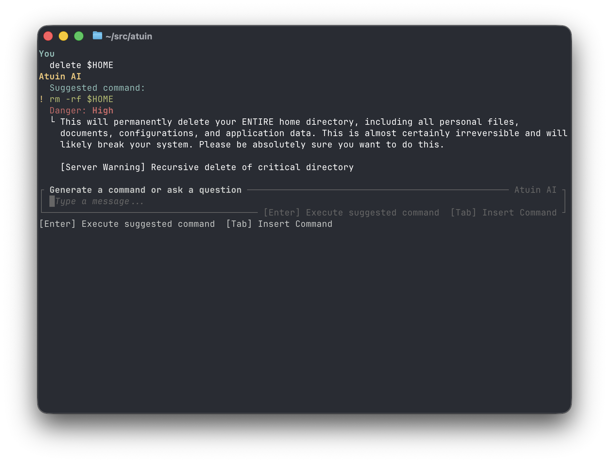

# Atuin SI

Atuin SI is a subcommand that enables shell command generation and other information lookup via an LLM directly from your terminal.

Atuin SI requires an account on [Atuin Hub](https://hub.atuin.sh/), and Atuin asks you to log in upon first use of the binary. Alternatively, you can [self-host the Atuin SI backend](./self-hosting.md).

Usage of Atuin SI is currently free.

## Getting Started

Atuin SI currently supports zsh, bash, and fish shells. See
[Supported platforms](../support.md) for the full support matrix. Your shell's usual `atuin init` call will automatically bind the question mark key to the Atuin SI UI (only when the prompt is empty).

!!! note "Disabling Atuin SI"

    You can disable the default question mark key binding by passing `--disable-si` to your shell's `atuin init` call, or by setting `si.enabled` to `false` in your Atuin config.

## Settings

For a list of settings that control the behavior of Atuin SI, see [its dedicated settings documentation](./settings.md).

## Features

### Command generation

Prompt the LLM to create a command, and get one back, no fuss. Press `enter` to run, or `tab` to insert.

### Follow-up

You can follow-up with another prompt to update the command that will be inserted.

You can also follow-up with questions to get responses in natural language.

You can still use `enter` or `tab` to run or insert the last suggested command, even if the LLM suggested it in a previous turn.

### Conversational and search usage

If you prompt the LLM with a question that doesn't imply you want to generate a command, it can respond in natural language, and use web search if necessary to fetch the data it needs.

### Dangerous or low-confidence command detection

The LLM scores its confidence in the command and how dangerous the command is. This information is shown if a threshold is exceeded, and requires an extra confirmation step before running automatically with `enter`.

The Atuin Hub server also monitors suggested commands for dangerous patterns the LLM didn't catch, and appends its own assessment at the end of the LLM's own assessment.

